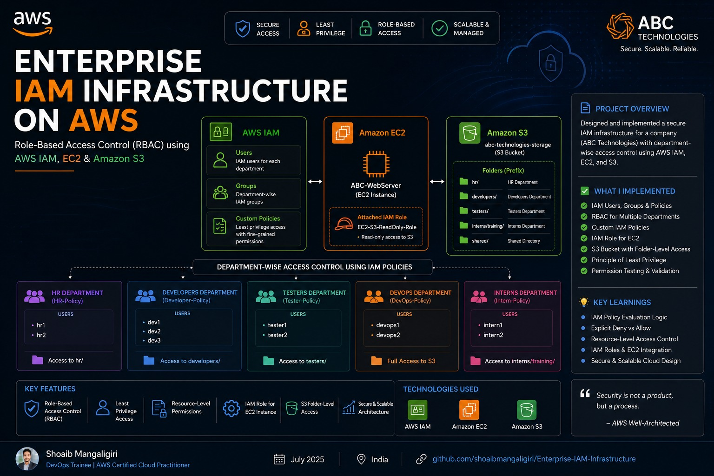

# Enterprise IAM Infrastructure on AWS

## Project Overview
Implemented a Role-Based Access Control (RBAC) model for a simulated organization, ABC Technologies, using AWS IAM.

## AWS Services Used
- AWS IAM
- Amazon EC2
- Amazon S3

## Departments
- HR
- Developers
- Testers
- DevOps
- Interns

## Key Implementations
- Created IAM users and groups.
- Designed custom IAM policies.
- Implemented department-wise access control.
- Applied the principle of least privilege.
- Configured S3 access permissions.
- Attached an IAM role to EC2.
- Tested permissions using different IAM users.

## Project Screenshots
Screenshots documenting the implementation will be added to this repository.

## Key Learnings
- IAM Users, Groups, Roles and Policies
- Role-Based Access Control (RBAC)
- Least Privilege
- S3 Permissions
- EC2 IAM Roles
- IAM Policy Evaluation

## Security
No AWS access keys, secret keys, or passwords should be uploaded to this repository.

## Author
Shoaib Mangalgi

DevOps Trainee | AWS | Linux | Cloud Computing
